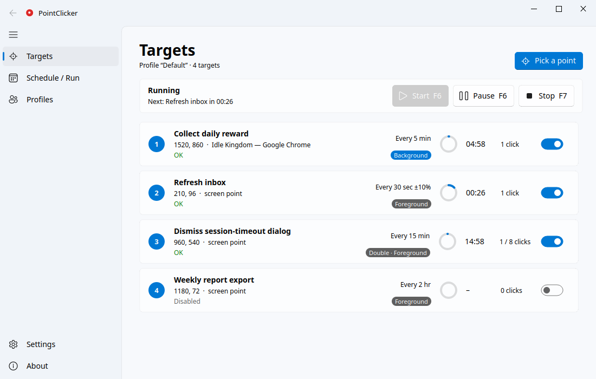
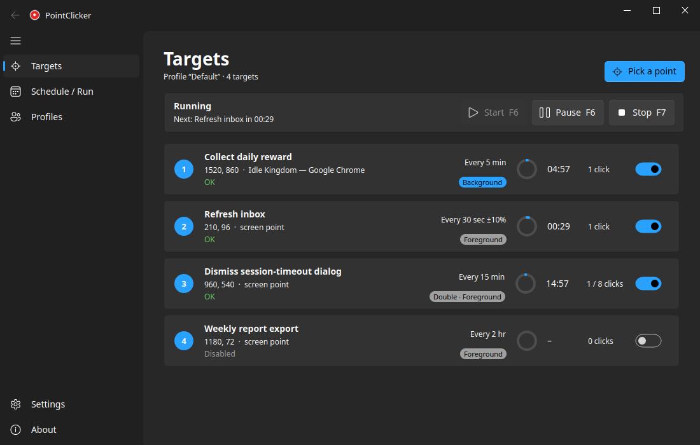
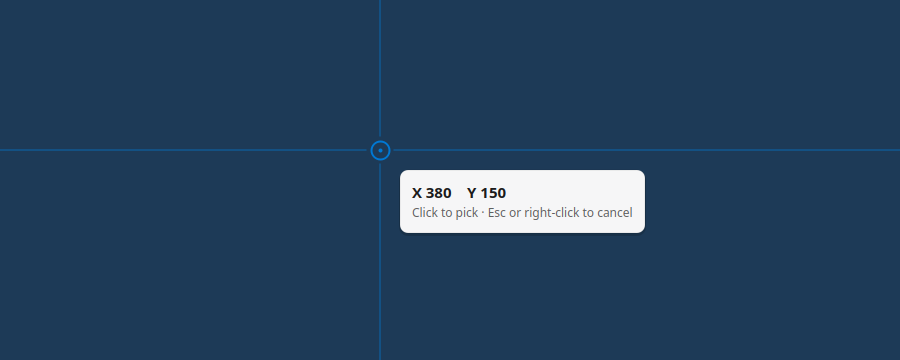
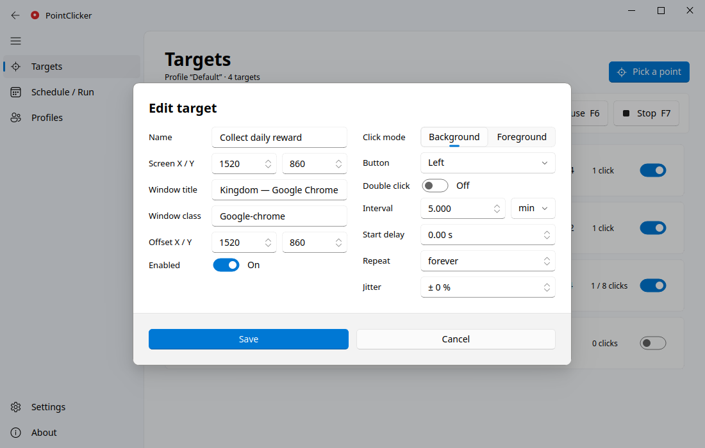
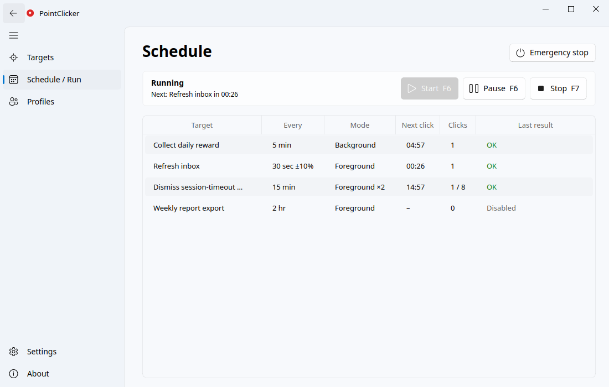
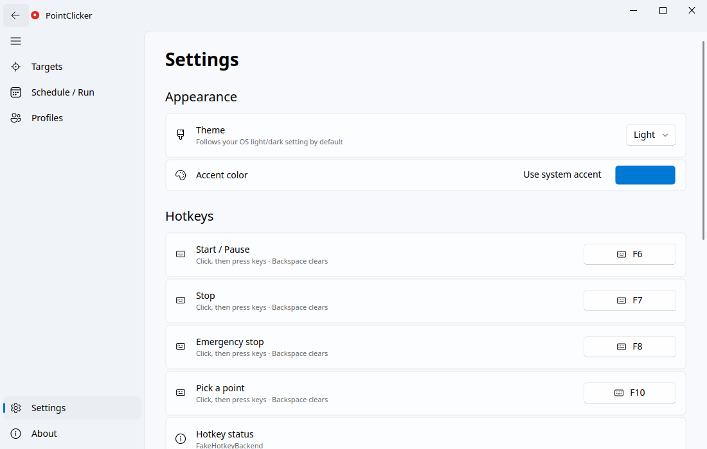

<div align="center">


# PointClicker

**A modern auto-clicker for fixed points on screen.**
Each point clicks on its own schedule, follows its window when the window moves, and on Windows and X11 can even click without moving your mouse.





</div>

---

## Contents

- [Features](#features)
- [Requirements](#requirements)
- [Installation](#installation): [Windows](#windows) · [Linux](#linux) · [Updating and uninstalling](#updating-and-uninstalling)
- [Quick start](#quick-start)
- [Using PointClicker](#using-pointclicker): [Targets](#targets-page) · [Editing a target](#editing-a-target) · [Schedule / Run](#schedule--run-page) · [Profiles](#profiles-page) · [Settings](#settings-page) · [Tray](#system-tray)
- [Hotkeys](#hotkeys)
- [Background vs. foreground clicks](#background-vs-foreground-clicks)
- [Platform notes](#platform-notes): [Windows](#windows-1) · [Linux X11](#linux-x11) · [Linux Wayland](#linux-wayland)
- [Diagnostics, logs and files](#diagnostics-logs-and-files)
- [Troubleshooting / FAQ](#troubleshooting--faq)
- [Safety and fair use](#safety-and-fair-use)
- [Known limitations](#known-limitations)
- [For developers](#for-developers)

---

## Features

- **Many targets, each on its own schedule.** For example, one target every 5 minutes and another every 30 seconds. Each target has its own:
  - interval in seconds, minutes or hours, with optional random jitter;
  - start delay;
  - repeat count, or forever.
- **Follows windows.** A target remembers the window it was picked on. If you move that window, the click moves with it.
- **Two click modes:**
  - **Background** sends the click straight to the window. Your mouse doesn't move, and the window can even be covered. Windows and X11 only.
  - **Foreground** performs a real click. It works almost everywhere; the pointer jumps for about 20 ms.
- **Smart suggestions.** If a background click visibly changed nothing, PointClicker offers to switch that target to foreground.
- **Live view.** Countdown rings, click counts and the last result for every target.
- **Global hotkeys** that work while other apps are focused. You can rebind them by pressing the keys you want.
- **Profiles:** separate sets of targets for different tasks.
- **Pick-a-point overlay** with a crosshair and live coordinates, plus optional on-screen markers.
- **A Windows 11-style (Fluent) interface** on both Windows and Linux:
  - light, dark, or follow-the-OS theme, with your accent color;
  - usable from 100% to 200% scaling and in windows as small as 800×550.
- **Safety:**
  - Pause and Stop take effect immediately.
  - An emergency stop disables every target.
  - Clicks wait while you're holding a mouse button yourself.

<p align="center"></p>

## Requirements

| | Supported |
|---|---|
| **Windows** | Windows 10 version 1703 or later, Windows 11 |
| **Linux** | Any desktop with X11, or Wayland with xdg-desktop-portal (GNOME, KDE Plasma, …) |
| **Python** | 3.11 or newer (only needed when running from source) |
| **macOS** | Not supported |

## Installation

There's no pre-built download yet. You can install from source in a few commands, or build your own `PointClicker.exe` on Windows.

### Windows

**Option A: run from source**

1. Install **Python 3.11+** from [python.org](https://www.python.org/downloads/). In the installer, tick **"Add python.exe to PATH"**.
2. Open **PowerShell** and run:

   ```powershell
   git clone https://github.com/khalilullahnaul/pointclicker.git
   cd pointclicker
   py -3.11 -m venv .venv
   .venv\Scripts\activate
   pip install -e .
   pointclicker
   ```

   No git? Use **Code → Download ZIP** on GitHub, unzip it, and run the same commands from the unzipped folder.

3. Next time, just run `.venv\Scripts\activate` and then `pointclicker` from that folder.

**Option B: build a standalone `PointClicker.exe`** (no Python needed afterwards)

```powershell
pip install -e ".[dev]"
python build.py            # → dist\PointClicker.exe (checks that it starts)
python build.py --admin    # also dist\PointClicker-Admin.exe, for clicking into admin windows
```

Copy `dist\PointClicker.exe` anywhere you like. It's a single file.

### Linux

**Easiest, with [pipx](https://pipx.pypa.io/):**

```bash
pipx install git+https://github.com/khalilullahnaul/pointclicker.git
pointclicker
```

**Or in a virtual environment:**

```bash
git clone https://github.com/khalilullahnaul/pointclicker.git
cd pointclicker
python3 -m venv .venv
source .venv/bin/activate
pip install -e .
pointclicker
```

If you use [uv](https://docs.astral.sh/uv/), run `uv sync`, then `uv run pointclicker`.

**System packages.** On X11, Qt needs `libxcb-cursor0`:

| Distribution | Command |
|---|---|
| Debian / Ubuntu | `sudo apt install libxcb-cursor0` |
| Fedora | `sudo dnf install xcb-util-cursor` |
| Arch | `sudo pacman -S xcb-util-cursor` |

On **Wayland**, also read [Linux Wayland](#linux-wayland): the first click asks for permission once, and global hotkeys may need a one-time setup.

### Updating and uninstalling

- **Update:**
  - in the cloned folder: `git pull`, then `pip install -e .`;
  - with pipx: `pipx upgrade pointclicker`.
- **Uninstall:** delete the folder (or run `pipx uninstall pointclicker`). Your settings and targets stay in the [config folder](#diagnostics-logs-and-files); delete that too for a clean removal.

## Quick start

1. **Start PointClicker** with `pointclicker` (or `PointClicker.exe`).
2. **Click "Pick a point".** The screen dims and a crosshair appears. Click the exact spot you want automated. Press **Esc** or right-click to cancel.
3. **Set the schedule** in the dialog that opens, for example *every 5 min*, then click **Save**.
4. **Press Start**, or press **F6** from any app. The countdown ring on the target's card shows when the next click happens.
5. **Pause** with **F6**, or **stop** with **F7**. **F8** is the emergency stop: it stops everything and disables all targets.

> **Tip:** if a click doesn't seem to do anything, open the target and switch **Click mode** to **Foreground**. See [Background vs. foreground](#background-vs-foreground-clicks).

## Using PointClicker

The sidebar has five pages. On wide windows it shows labels; on narrow windows it collapses to icons. Click ☰ to expand it.

### Targets page

Each target is a card:

| Element | Meaning |
|---|---|
| **Number** | The target's position in the list (also shown on the on-screen markers) |
| **Name** and line below | Coordinates, and the window it's attached to (or *screen point*) |
| **Status** (colored) | *Ready*, *OK*, *Failed: …*, *Window not found*, *Disabled*, *Done* |
| **Every …** | Interval, plus jitter if set |
| **Badge** | Click mode: Background / Foreground, and *Double* for double clicks |
| **Ring + time** | Countdown to the next click |
| **Clicks** | Clicks done in this run, e.g. `3 / 8 clicks` if the target has a repeat limit |
| **Switch** | Enable or disable the target |

- **Hover** a card for **Edit**, **Test click now**, **Duplicate** and **Delete**, or right-click it for the same menu.
- **Click** a card to edit it.
- **Test click now** clicks once immediately and reports the result, including whether the window visibly changed.

### Editing a target

<p align="center"></p>

| Field | What it does |
|---|---|
| **Name** | A label for you |
| **Screen X / Y** | The screen point that was picked |
| **Window title / class** | The window the target follows. Leave the class empty for a fixed screen point |
| **Offset X / Y** | Where in that window to click, relative to its top-left corner |
| **Enabled** | Off = skipped by the scheduler |
| **Click mode** | Background or Foreground ([details](#background-vs-foreground-clicks)) |
| **Button** | Left, right or middle |
| **Double click** | Send a double click instead of a single one |
| **Interval** + unit | Time between clicks: sec, min or hr |
| **Start delay** | Wait this long after Start before the first click |
| **Repeat** | Number of clicks per run; *forever* = no limit |
| **Jitter** | Randomize each interval by ± this percent, so clicks don't land like clockwork |

### Schedule / Run page

<p align="center"></p>

This page is a table of every target, with its interval, mode, next click, click count and last result. It also has the command bar, and an **Emergency stop** button.

- **Pause** freezes all countdowns exactly where they are. **Resume** continues from there.
- **Stop** cancels everything and resets the countdowns.

### Profiles page

A profile is an independent set of targets, for example "Game" and "Work". You can create, rename, delete and switch profiles here. Switching profiles stops the clicker first.

### Settings page

<p align="center"></p>

| Group | Settings |
|---|---|
| **Appearance** | Theme: system, light or dark. Accent color, or *Use system accent* |
| **Hotkeys** | Click a hotkey button, then press the new combination. **Esc** cancels, **Backspace** turns the hotkey off. The status line says which hotkey mechanism is in use, or why hotkeys are unavailable |
| **Behavior** | Default click mode for new points · Minimize to tray · Start minimized · Start clicking on launch · Launch at login · Show target markers |
| **Linux permissions** (Linux only) | Shows whether PointClicker can use `/dev/uinput` and read keyboards, with a **Setup guide** button |

### System tray

- **Minimizing** hides PointClicker in the system tray (you can turn this off in Settings).
- **Tray menu:** Show, Start/Pause, Stop, Emergency stop, Pick a point, Quit.
- **Closing the window** quits the app.
- **Notifications** appear as tray messages while the window is hidden.

## Hotkeys

The hotkeys work while any app is focused. You can change them in **Settings → Hotkeys**.

| Default | Action |
|---|---|
| **F6** | Start / Pause / Resume |
| **F7** | Stop |
| **F8** | Emergency stop: stops and **disables every target** |
| **F10** | Pick a point. On Windows and X11 it adds the point under the mouse; on Wayland it opens the picker |

Combinations such as `Ctrl+Alt+S` work too. **Note:** F10 also opens the menu bar in many apps, and those apps still receive it. Pick a different key if that bothers you.

## Background vs. foreground clicks

| | **Background** | **Foreground** |
|---|---|---|
| How | Sends the click straight to the target window | Moves the pointer, clicks for real, moves it back |
| Your mouse | Never moves | Jumps for about 20 ms |
| Covered window | Still gets the click | No: whatever is on top gets the click |
| Works with | Classic desktop apps: Notepad, dialogs, many tools | Almost everything that accepts a mouse click |
| Ignored by | Most games, many browsers, Electron and UWP apps | — |
| Available on | Windows, Linux X11 | Windows, Linux X11, Linux Wayland |

**Rule of thumb:** try **Background** first. If nothing happens, use **Foreground**.

PointClicker checks this for you. It compares the window before and after the first background click of each run, and after **Test click now**. If nothing changed, it asks whether to switch that target to foreground. It's a guess: if the click did work but changes nothing visible, keep background.

## Platform notes

### Windows

- **Mica:** Windows 11 gets the Mica window background; Windows 10 gets a solid one.
- **Accent color:** the default accent is your Windows accent color.
- **Admin windows:** Windows blocks normal apps from clicking into apps that run **as administrator**. PointClicker shows a red notice when a target window is elevated. To click into such windows, run **PointClicker-Admin.exe**, or right-click PointClicker → *Run as administrator*.

### Linux X11

- **Foreground clicks:** the pointer moves, clicks via XTest, and moves back (about 2 ms).
- **Background clicks:** sent as synthetic X events, which **many apps ignore**. Use foreground when they do.
- **Hotkeys:** grabbed from X11, and they keep working with NumLock or CapsLock on. If another app already owns a key, Settings → Hotkeys says so.

### Linux Wayland

Wayland is stricter than Windows or X11. Apps can't read the pointer position or send input to other apps' windows. PointClicker works within those rules:

- **Permission dialog (once).** The first time PointClicker needs to click, your desktop asks for **Remote Desktop / screen sharing** permission. Choose **Share** and keep **remote interaction** allowed. PointClicker remembers the permission, so you aren't asked again. While it's active, GNOME shows a sharing indicator in the top bar; using it to stop sharing revokes access.
- **No background mode.** It's disabled in the editor, with an explanation.
- **The pointer stays where the click happened.** Wayland doesn't let apps read the pointer position, so it can't be put back.
- **Picking:** use **Pick a point**; the pick hotkey opens the same picker.
- **Window tracking** works only for X11 apps running through XWayland. On-screen markers aren't available.
- **Hotkeys:** PointClicker uses the desktop's *GlobalShortcuts* portal where one exists (KDE Plasma, GNOME 48+). Otherwise it needs read access to the keyboards, so the one-time setup below.

**One-time setup** (only if hotkeys say *unavailable*, or if the permission dialog is unavailable or was denied):

```bash
echo 'KERNEL=="uinput", GROUP="input", MODE="0660", OPTIONS+="static_node=uinput"' | sudo tee /etc/udev/rules.d/60-pointclicker.rules
sudo udevadm control --reload-rules && sudo udevadm trigger
sudo usermod -aG input $USER     # then log out and back in
```

> **Security note:** members of the `input` group can read every keystroke and inject input. Only do this on a computer you trust. To undo it:
> `sudo gpasswd -d $USER input && sudo rm /etc/udev/rules.d/60-pointclicker.rules`

## Diagnostics, logs and files

**Diagnostics.** Run this in a terminal:

```bash
pointclicker --diagnose
```

It prints your session type (Windows / X11 / Wayland / XWayland), the click and hotkey methods in use, permissions, desktop portals and monitors. Then it runs a **self-test click** on a full-screen test window, and ends with `Result: PASS` or `FAIL`. Include this output when asking for help.

| What | Windows | Linux |
|---|---|---|
| Settings, targets, profiles | `%LOCALAPPDATA%\PointClicker\config.json` | `~/.config/pointclicker/config.json` |
| Logs (rotated, 1 MB × 5) | `…\PointClicker\logs\pointclicker.log` | `~/.config/pointclicker/logs/pointclicker.log` |
| Wayland permission token | — | `~/.config/pointclicker/portal_restore_token` |

- **Opening these folders:** the **About** page has **Open log folder** and **Open config folder** buttons.
- **Saving is safe:** a crash mid-save can't corrupt `config.json`.
- **Unreadable config:** if the file can't be read, it's moved aside to `config.bad.json` instead of being overwritten.

## Troubleshooting / FAQ

<details><summary><b>The click "succeeds" but nothing happens in the app</b></summary>

The app ignores background clicks. Edit the target and set **Click mode → Foreground**. Games, browsers and Electron or UWP apps usually need this.
</details>

<details><summary><b>Status says "Window not found"</b></summary>

The window the target was picked on is closed, or its title changed. Open it again, or edit the target:
- change the **window title** to match;
- or clear the **window class**, to click a fixed screen point instead.
</details>

<details><summary><b>"Target window is minimized"</b></summary>

Minimized windows can't be clicked in either mode. Keep the window restored. With background mode it can stay behind other windows.
</details>

<details><summary><b>Windows: clicks into an app do nothing and there's a red "administrator" notice</b></summary>

The target app runs as administrator. Run `PointClicker-Admin.exe`, or start PointClicker as administrator.
</details>

<details><summary><b>Wayland: I denied the permission dialog, or it never appeared</b></summary>

Restart PointClicker; it asks again on the next click. If clicking stopped after you used "Stop sharing" in the top bar, delete `~/.config/pointclicker/portal_restore_token` and restart. If your desktop has no Remote Desktop portal, do the [one-time setup](#linux-wayland) to use the uinput fallback. Then run `pointclicker --diagnose` to check.
</details>

<details><summary><b>Hotkeys don't work</b></summary>

1. Open **Settings → Hotkeys** and read the status line.
2. **Wayland:** without a GlobalShortcuts portal, hotkeys need the [one-time setup](#linux-wayland).
3. **X11:** another app may own the key; the status line names it. Choose a different combination.
4. **Windows:** some games and admin apps swallow keys. Try running PointClicker as administrator.
</details>

<details><summary><b>Linux: the app doesn't start ("could not load the Qt platform plugin xcb")</b></summary>

Install `libxcb-cursor0` (see [Linux installation](#linux)).
</details>

<details><summary><b>Clicks land slightly off after moving a window to another monitor</b></summary>

Offsets are stored in physical pixels. A window moved to a monitor with different scaling shifts the point. Re-pick the target on its new monitor.
</details>

<details><summary><b>Can I use it in games?</b></summary>

Read [Safety and fair use](#safety-and-fair-use) first.
</details>

## Safety and fair use

- **Games with anti-cheat** (Vanguard, Easy Anti-Cheat, BattlEye, …) can detect automated input. Using an auto-clicker there can get your account **banned**. Don't.
- **Services and websites:** respect their terms of service, and don't use PointClicker to spam, inflate counts or overload anything.
- **Stopping:** keep **F8 (emergency stop)** in mind whenever targets run at short intervals.

## Known limitations

- **Background mode:** Windows and X11 only, and many apps ignore it (see above).
- **Wayland:** the pointer isn't restored after a click, window tracking only works for XWayland apps, and there are no markers.
- **Finding windows:** matched by class and title. With several identical windows open, it may pick the wrong one.
- **Lock screen, UAC prompts and minimized Remote Desktop sessions** accept no synthetic input.
- **macOS** isn't supported.

## For developers

```bash
git clone https://github.com/khalilullahnaul/pointclicker.git && cd pointclicker
uv sync --extra dev          # or: python -m venv .venv && pip install -e ".[dev]"
uv run pytest                # unit, scheduler, platform, controller and UI tests (UI runs offscreen)
uv run pointclicker --diagnose
```

| Path | Purpose |
|---|---|
| `src/pointclicker/platform/` | Click backends: `windows/` (Win32), `linux/x11.py` (XTest/XSendEvent), `linux/wayland.py` (portal/uinput), `linux/hotkeys.py`, plus a `fake` backend for tests |
| `src/pointclicker/scheduler.py` | One scheduler thread with a priority queue; pause/stop take effect instantly |
| `src/pointclicker/targets.py` | Target model and JSON profiles |
| `src/pointclicker/controller.py` | All app logic between UI and engine. The UI only uses its slots and signals |
| `src/pointclicker/ui/` | Fluent UI built with [PySide6-Fluent-Widgets](https://github.com/zhiyiYo/PyQt-Fluent-Widgets) |
| `src/pointclicker/overlay.py` | Pick-a-point overlay and on-screen markers |
| `src/pointclicker/diagnose.py` | `pointclicker --diagnose` |
| `scripts/test_apps.py` | Windows: real click test against Notepad, Chrome and Calculator |
| `build.py` | PyInstaller build of `PointClicker.exe` (and the admin variant) |

Bug reports are welcome: open an issue, and include your OS and the output of `pointclicker --diagnose`.

## License

No license has been chosen yet. Until one is added, all rights are reserved by the author.
